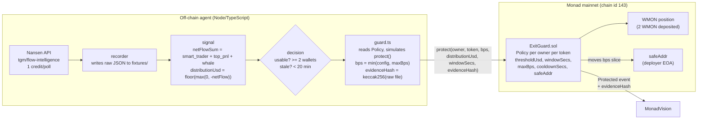

# Smart Money Exit Guard

An off-chain agent watches **Nansen smart-money distribution** for a token on Monad. When
distribution crosses an owner-defined threshold inside the owner-defined window, the agent calls
`protect()` on the Monad contract, which moves a capped share of the owner's deposited position
to the owner's safe address.

**The contract enforces the policy on-chain.** The agent cannot move more than `maxBps`, cannot
act on a different window, cannot trigger twice inside `cooldownSecs`, and cannot send funds
anywhere except the owner's `safeAddr`. The agent is a trigger, not a custodian.

Every trigger commits a `keccak256` hash of the exact raw Nansen JSON response that justified it,
so the decision is provable against the source data after the fact.

---

## Architecture



---

## Why Monad

Monad is used here as **cheap, final execution** — not as a real-time signal source.

- `protect()` is a single state-changing call with a capped transfer, so cost and finality matter
  and nothing else does.
- The signal itself arrives **off-chain from Nansen**. Nothing on Monad is read to make the
  decision, and the chain is not expected to produce the signal faster.
- A fast finality chain means the protective transfer settles promptly once the agent decides, so
  funds are not left exposed between decision and settlement.

**Honest caveat:** the practical latency of this system is dominated by the Nansen data refresh,
not by Monad. Nansen documents that **responses are cached 10–30 minutes** depending on
timeframe, and that recent (~24h) data is live while older data comes from an hourly batch that
can lag up to an hour. This system is a *distribution* detector on that cadence, not a
sub-second market maker.

---

## Deployed addresses (Monad mainnet, chain id 143)

| | |
|---|---|
| ExitGuard | `0x921621dC0de402adB75a84479046e5150c5a10D5` |
| Guarded asset | WMON `0x3bd359C1119dA7Da1D913D1C4D2B7c461115433A` (canonical Wrapped MON) |
| Deposit | 2 WMON (18 decimals) |
| Policy | threshold $1000 · window 21600s (6h) · maxBps 2500 · cooldown 3600s |
| Owner / safeAddr | `0x027b756B9B411c2838926534b3D5e119B8De8f2e` |
| Agent / guard | `0x68a691c461c54CE767C6d539022fa344397b9f31` |
| Explorer | https://monadvision.com/address/0x921621dC0de402adB75a84479046e5150c5a10D5 |
| Verification | Sourcify `exact_match` (creation + runtime), job `c27bb8b3-fe37-478c-983e-c008ad2a745d` |

Full details in [`deployments.json`](./deployments.json).

---

## The signal

Endpoint: **`POST /api/v1/tgm/flow-intelligence`** (1 credit/call), via
`nansen research token flow-intelligence --chain monad --token <token>`.

Segments used for the decision — `smart_trader`, `top_pnl`, `whale`:

```
netFlowUsd      = smart_trader_net_flow_usd + top_pnl_net_flow_usd + whale_net_flow_usd
distributionUsd = floor(max(0, -netFlowUsd))
usable          = (sum of *_wallet_count) >= 2
```

Deliberately **excluded** from decisions: `exchange` (CEX flow is not smart-money distribution),
`fresh_wallets` (not smart money), `public_figure`.

Tokens that return no usable data are **skipped, never faked**.

See [`NANSEN_USAGE.md`](./NANSEN_USAGE.md) for every command, every field consumed, and which
decision each one feeds.

---

## Signal window

The signal window is the endpoint's **default `timeframe` of `1d`**. `nansen-cli` v1.21.0 never
forwards `--days` to this endpoint (verified in `src/api.js:1047-1058` and by direct raw-HTTP
request). **Whether that `1d` bucket is rolling or calendar-aligned to UTC is not specified in the
docs and has not been verified** — see `logs/recorder.log` for the measured behaviour around the
00:00 UTC boundary. The on-chain `windowSecs = 86400` matches one `1d` bucket in duration.

---

## Setup

```bash
# 1. contracts
forge install foundry-rs/forge-std
forge test                       # 8 tests, all must pass

# 2. env
cp .env.example .env
#   NANSEN_API_KEY=...
#   DEPLOYER_PRIVATE_KEY=...    owner + safeAddr
#   AGENT_PRIVATE_KEY=...       guard only
#   MONAD_RPC_URL=https://rpc.monad.xyz
```

Note: the `nansen` CLI reads `NANSEN_API_KEY` from the environment, **not** from a project `.env`.
The agent loads `.env` into the process environment before shelling out.

```bash
# 3. agent
cd agent && npm install
npm run probe        # find tokens with real smart-money activity (1 credit each)
npm run record       # background recorder, writes raw Nansen JSON to fixtures/ and logs/poll/
npm run loop         # decision loop (MODE=DRY_RUN default)

# 4. frontend
cd ../web && npm install && npm run dev
# needs the agent api serving logs/latest.json
cd ../agent && npm run api      # http://127.0.0.1:8791/api/latest
```

### Modes

| Mode | Nansen cost | Sends tx | Use |
|---|---|---|---|
| `DRY_RUN` | 0 (reads fixtures) | no | default; verifies the decision path |
| `REPLAY` | 0 | no | runs identical logic over recorded real responses |
| `LIVE` | 0 (reads fixtures) | yes | only after threshold is set and owner approves |

Safety guards that apply in **every** mode: fixture staleness > 20 min → skip; wallet count
below 2 → skip; any `protect()` revert condition → skip locally before spending gas.

---

## Trust assumptions (read this before judging the design)

**The contract does not verify the Nansen number.** `protect()` accepts a
`distributionUsd` value supplied by the caller and compares it against the owner's
`thresholdUsd`. Nothing on-chain re-derives that figure from Nansen, and it cannot: Nansen data
is off-chain. This system therefore **trusts the agent to report the signal honestly**.

What the owner gives up is bounded on-chain:

| Bounded by | Effect |
|---|---|
| `maxBps` | the agent can move at most a capped share of the deposit per trigger |
| `safeAddr` | funds can only go to the address the owner set, never elsewhere |
| `cooldownSecs` | the agent cannot trigger repeatedly in quick succession |
| `windowSecs` | the window is fixed by the policy; the agent cannot substitute its own |
| `guard` | only the owner-designated address can call `protect()` at all |
| `revokeGuard` | the owner can set `guard = 0` and permanently disable the agent |

A compromised or malicious agent can therefore cause a **bounded, rate-limited move of the
owner's own funds to the owner's own safe address** — and nothing else. It cannot drain, cannot
redirect, and cannot act after revocation. But it *can* trigger early by overstating
`distributionUsd`, up to `maxBps` per cooldown period. That is the deliberate trade-off: the
owner trades a bounded, capped loss for an uncapped risk of holding through a distribution event.

`evidenceHash` is an **audit commitment, not an input to the decision**. The contract stores it
and never checks it. Its purpose is after-the-fact verifiability: anyone can take the
`keccak256` of the recorded Nansen response and prove it is the exact data that justified the
trigger.

```bash
cast keccak 0x$(xxd -p < fixtures/_evidence/<file>.json | tr -d '\n')
```

What is *not* trusted: the `distributionUsd` value. What *is* trusted: the contract code (verified
on Sourcify, `exact_match`) and the owner's own policy values.

---

## The signal window: 6h, chosen before testing

`timeframe` is a real parameter of the Nansen endpoint, and the window materially changes the
answer for the same token:

| WMON | 1h | 6h | 1d |
|---|---|---|---|
| summed net flow (smart_trader + top_pnl + whale) | −448.28 | **−6363.99** | **+3374.16** |
| summed wallet count | 1 | **3** | 4 |

**WMON reads as inflow at `1d` and outflow at `6h`.** The `6h` window was selected **before
any test-trigger tuning** — it was chosen when the `nansen` CLI was found to silently drop
`--days`, which forced the agent onto the endpoint's `1d` default, and the REST `timeframe`
parameter was then introduced. The threshold (`1000`) was set independently and was not
adjusted to make the 6h figure trip.

Caveats stated plainly:
- The decision cohort is **3 wallets**. `minWalletCount = 2` is satisfied, but a 3-wallet cohort
  is a small sample and a single wallet can dominate the figure.
- A 6h window is shorter than the documented **10–30 minute response cache** is long relative to,
  so consecutive polls can return the same cached data.
- `1d` and `6h` disagree in *sign*. Neither is "correct"; they are different questions.

---

## Published data (what is and isn't in this repo)

The agent records every Nansen response it reads, but **not every recorded response is
published**:

| Path | Published | Purpose |
|---|---|---|
| `fixtures/_sample/` | ✅ yes | one early + one late response per tracked token |
| `fixtures/_evidence/` | ✅ yes (once populated) | the **exact** files whose `keccak256` is committed in on-chain `Protected` events |
| `fixtures/*.json` (everything else) | ❌ no, gitignored | routine poll history, regenerated by running the recorder |

`logs/`, `out/`, `cache/`, `broadcast/` and `lib/` are gitignored. No private key, API key or
mnemonic appears anywhere in the repository or its git history — `.env` is ignored and only
`.env.example` is committed.

Verify any published evidence file against its on-chain hash with:

```bash
cast keccak 0x$(xxd -p < fixtures/_evidence/<file>.json | tr -d '\n')
```

---

## Testing

```bash
forge test -vv
```

8 tests covering: bps movement to safe address, guard-only access, below-threshold revert, bps cap
revert, window mismatch revert, cooldown behaviour, guard revocation, owner withdrawal.

---

## Honest limitations

1. **The contract trusts the agent's `distributionUsd`.** It is bounded by `maxBps`, `cooldownSecs`
   and `safeAddr`, but it cannot verify the number. See "Trust assumptions" above.
2. **The decision cohort is 3 wallets.** Small sample; one wallet can dominate the figure.
3. **Signal latency is minutes, not milliseconds.** Nansen caches responses 10–30 minutes, which
   is long relative to a 6h window.
4. **`1d` and `6h` disagree in sign for WMON** (+3374 vs −6364). The window is a modelling choice,
   not a fact about the market.
5. **No live `protect()` transaction has been executed yet.** The contract is deployed, verified,
   funded and governed, and the position is currently TRIGGER ELIGIBLE, but no transaction has
   been sent because the agent runs in DRY_RUN.
6. **Monad smart-money label coverage is thin right now.** A probe of 111 non-stablecoin Monad
   mainnet tokens found only 4 with a summed wallet count ≥ 2 across the three decision segments.
7. **Two unrelated tokens showed a suspicious numeric coincidence** (`-4379.91` and `-4379.82`)
   that is not yet explained. Both are 1–2 wallet cohorts and are treated as low confidence.
8. **Single asset.** Only WMON has a position. cbBTC is tracked observationally and is an EIP-1967
   proxy whose implementation is upgradeable by a third party.

## License

MIT
