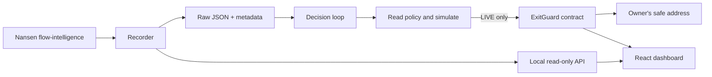

# Nanpolis — Smart Money Exit Guard

Nanpolis watches Nansen flow intelligence for WMON on Monad and shows the signal beside an owner's on-chain protection policy. An off-chain agent can transfer a capped percentage of deposited tokens to the owner's configured safe address when its signal meets that policy.

**A transfer to a safe address does not sell, hedge, or remove token price exposure.** The contract trusts the designated guard's reported distribution figure. The evidence hash is an audit commitment, not an oracle proof.

## Run locally

Requires Node.js 22.12+ and npm. From the repository root:

```bash
npm run setup
npm run dev
```

Open the Vite URL printed in the terminal (normally http://127.0.0.1:5173). This starts the API and dashboard in **historical demo mode**, using the committed Nansen samples. It needs no key and sends no transactions. Historical samples do not establish current conditions, and their original timeframe metadata was not committed.

```bash
npm run replay          # offline historical signal calculations, no policy execution
npm run check           # agent + web types, agent tests, production web build
```

The API listens on `127.0.0.1:8791`. Vite proxies `/api` to it. Stop both services with Ctrl+C.

## Live data and dry-run decisions

```bash
cp .env.example .env
# Set NANSEN_API_KEY and MONAD_RPC_URL in .env.
npm run dev:live
```

This starts the recorder, API, and web app. Recording consumes Nansen API credits. It does **not** start the transaction loop. To evaluate a fresh recorded response against the configured on-chain policy:

```bash
cd agent
MODE=DRY_RUN ONE_SHOT=1 npm run loop
```

Run the loop without `ONE_SHOT=1` to continue polling. `MODE=LIVE` enables signing and submission and requires the designated agent's private key. Keep the default dry-run mode until the deployment, policy, safe address, and signer have been independently checked. No live transaction was sent as part of completing this repository.

Only tokens marked `canTrigger: true` in `agent/config.json` may trigger. Other assets are observational. RPC failures, missing or stale data, invalid metadata, and unusable cohorts must not become positive protection decisions.

## Architecture



- `src/`, `test/`, `script/`: Solidity vault, regression tests, deployment script.
- `agent/`: REST recording, validation, policy checks, transaction submission, replay, HTTP API.
- `web/`: React/Vite read-only dashboard with on-chain reads.
- `fixtures/_sample/`: original historical Nansen responses.
- `fixtures/_evidence/`: exact raw files committed by protection event hashes when generated.
- `deployments.json`: historical deployment record; it is not proof of current balance or policy.

## Signal and trust model

The recorder sends an explicit `timeframe` (default `6h`, 21600 seconds) to `POST /api/v1/tgm/flow-intelligence`. The decision sums `smart_trader`, `top_pnl`, and `whale` net flows:

```text
netFlowUsd      = sum(segment net_flow_usd)
distributionUsd = floor(max(0, -netFlowUsd))
usable          = sum(segment wallet_count) >= 2
```

Segment counts are summed, **not deduplicated across cohorts**. Flows may likewise overlap between labels. This heuristic must not be interpreted as a unique-wallet count or an independently verified total market outflow. Exchange, fresh-wallet, and public-figure segments are excluded.

The fixture's recorded timeframe must match the owner's on-chain window. Freshness is bounded by the recorder timestamp; repeated or cached upstream data can still be older than the fetch. Nansen cadence and cohort quality constrain the usefulness of the signal.

On-chain policy limits the guard's authority through `maxBps`, `cooldownSecs`, `safeAddr`, and owner revocation. These are **per-trigger bounds**: repeated triggers can move most of the remaining deposit over time. The guard cannot redirect the destination, but a compromised guard can report false distribution and trigger early. The safe address receives the same token, so market-price exposure remains.

`evidenceHash` is `keccak256` of the exact response bytes, not reserialized JSON. Matching a hash proves which bytes were committed, not that Nansen produced them or that the number was truthful.

## Contracts

Install [Foundry](https://getfoundry.sh/introduction/installation/), then:

```bash
forge install foundry-rs/forge-std@v1.17.0
forge test -vv
```

The updated source hardens token handling and reentrancy and includes regression tests. Only fixed-balance ERC20 tokens with exact transfers are supported; fee-on-transfer and rebasing tokens are unsuitable. **It differs from the previously deployed contract.** Existing deployment verification applies to the historical bytecode, not these changes. A new deployment and explicit migration are necessary to use the hardened source; nothing here upgrades or migrates existing funds automatically.

Historical Monad mainnet deployment (chain ID 143):

| Field | Recorded value |
|---|---|
| ExitGuard | `0x921621dC0de402adB75a84479046e5150c5a10D5` |
| WMON | `0x3bd359C1119dA7Da1D913D1C4D2B7c461115433A` |
| Owner | `0x027b756B9B411c2838926534b3D5e119B8De8f2e` |
| Agent | `0x68a691c461c54CE767C6d539022fa344397b9f31` |

[Historical contract on MonadVision](https://monadvision.com/address/0x921621dC0de402adB75a84479046e5150c5a10D5). Current balances, policy, and activity must be read from the network, not inferred from this table. The read-only application is configured around this owner and asset; it does not manage arbitrary connected-wallet positions.

## Configuration and operation

`.env.example` documents runtime settings. Keep credentials in the ignored root `.env`. Never put private keys or the Nansen key in `VITE_*` variables or frontend source.

The local API provides `/api/latest`, `/api/history`, and `/api/protections`. An absent recorder snapshot is unavailable data, not zero distribution. Demo responses are explicitly labeled. `web/dist` is a static production build; a production host must route `/api` to the running read-only agent API. The Vite development proxy is not a production server.

Run only one live decision worker per signer and deployment. Keep the recorder and worker supervised, persist fixtures and logs, retain evidence before operating live, monitor RPC/API failures, and provide MON for gas. Local files and the API are not a multi-user hosted backend. This repository has no external security audit.

The deployment script is an operator tool. Review its inputs and target chain before signing; source changes alone do not alter `deployments.json` or existing funds. No credentials, paid API requests, mainnet operations, or hosting account are necessary for the historical demo and automated tests.

## References checked during completion

- [Nansen Flow Intelligence API](https://docs.nansen.ai/api/token-god-mode/flow-intelligence): endpoint, explicit timeframe, response fields.
- [Monad network information](https://docs.monad.xyz/developer-essentials/network-information): mainnet chain ID and RPC configuration.
- [Viem contract simulation](https://viem.sh/docs/contract/simulateContract): simulate before submitting a contract call.

See [DEMO_SCRIPT.md](./DEMO_SCRIPT.md) for a reproducible presentation and [NANSEN_USAGE.md](./NANSEN_USAGE.md) for the original research notes. Those notes describe historical observations, not current market conditions.

MIT license.
